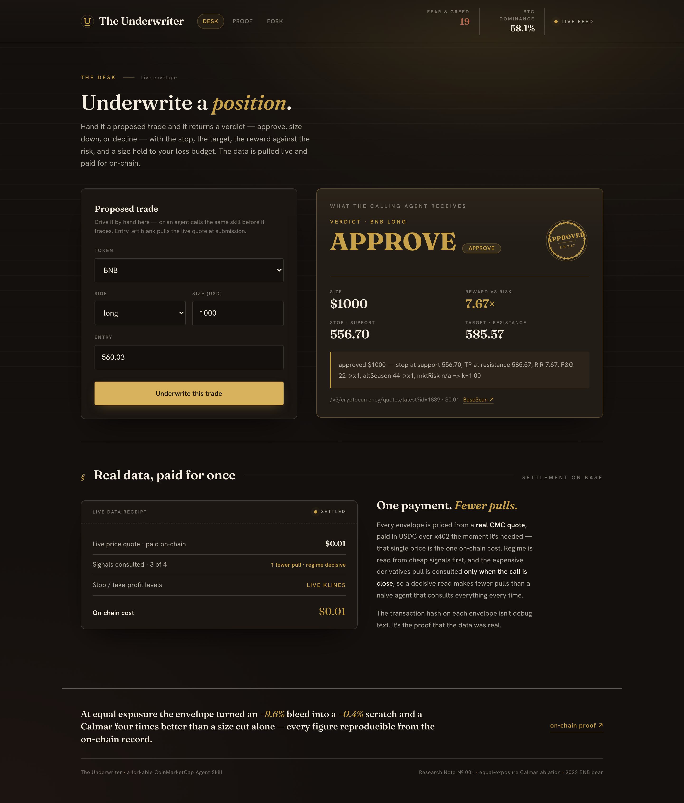
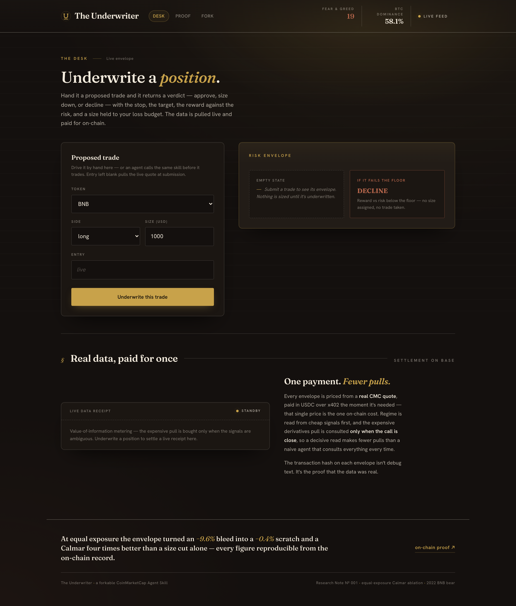
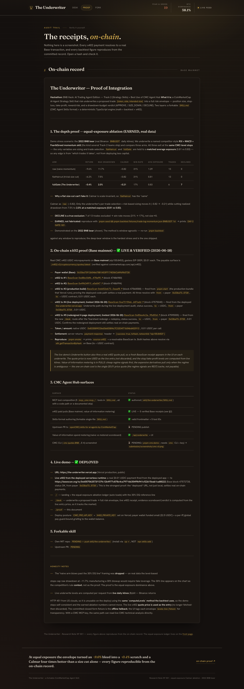
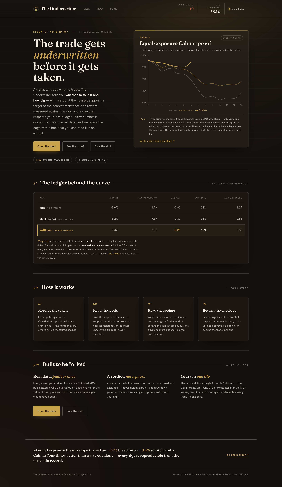
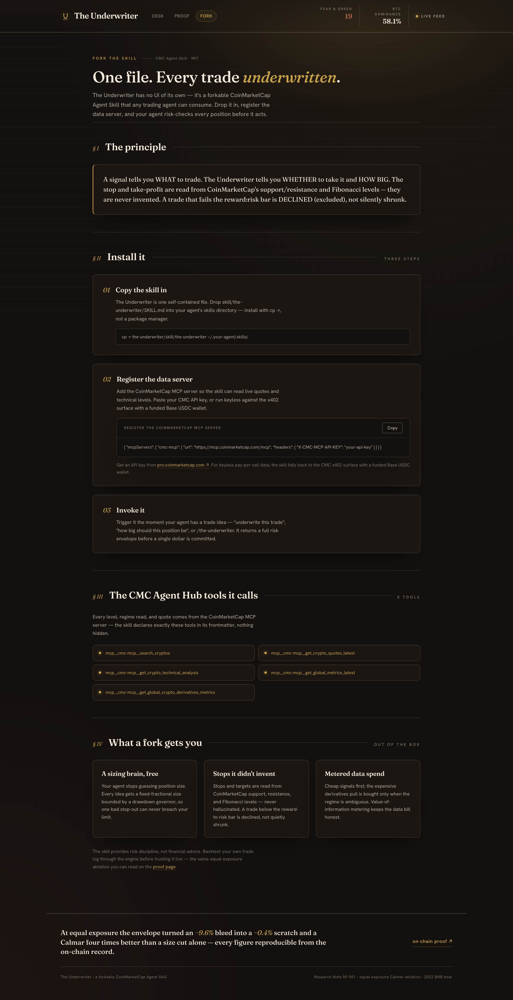

# The Underwriter: a CoinMarketCap risk-underwriting skill for trading agents

The Underwriter turns a proposed crypto trade into a full risk envelope: position size, stop-loss, take-profit, reward:risk, and an APPROVE / SIZE_DOWN / DECLINE verdict. Stops and targets are read from live CoinMarketCap-method support, resistance, and Fibonacci levels, never invented. A trade that fails the 2:1 reward:risk floor is declined outright, and every position is clamped so a single stop-out cannot breach the portfolio drawdown budget.

[](https://www.typescriptlang.org/)
[](https://nextjs.org/)
[](https://basescan.org/address/0x33ba73912604b678B1A53FF174D06Cd49d9b5728)
[]()
[](LICENSE)

**Live:** [the-underwriter.vercel.app](https://the-underwriter.vercel.app)

---



## Live Demo

**[the-underwriter.vercel.app](https://the-underwriter.vercel.app)**

Open the desk, propose a trade (token, side, size, optional entry), and underwrite it. The price is pulled from a live CoinMarketCap quote paid for with a real USDC micropayment on Base, the stop and target are computed from live daily candles, and the on-chain receipt for that pull appears on the envelope.

---

## What Is The Underwriter?

A signal tells you what to trade. The Underwriter tells you whether to take it and how big. It is a forkable CoinMarketCap Agent Skill (a single `SKILL.md`) backed by a deterministic TypeScript risk engine, so any trading agent can size a position, place a stop, and stay under a max-drawdown limit before it acts.

It pays for its market data per call over x402 (no API key required) and proves its edge with a reproducible backtest you can read like an exhibit.

---

## Screenshots

| The desk (live underwrite) | On-chain proof |
|------|------|
|  |  |
| **Landing + equal-exposure ablation** | **Fork and install** |
|  |  |

---

## Features

- **Levels, never invented.** Stop and take-profit come from CoinMarketCap-method pivots and Fibonacci levels computed from live daily candles. If the levels are missing, the trade declines rather than guessing.
- **DECLINE is a real exclusion.** A trade below the 2:1 reward:risk floor is rejected, not silently shrunk to a token size.
- **Drawdown governor.** Position size is clamped to a fraction of the remaining drawdown budget, so one stop-out cannot breach the max-drawdown limit.
- **Value-of-information metering.** Cheap regime signals are read first. The expensive derivatives pull is bought only when the regime is ambiguous.
- **Pay-per-call data over x402.** Each underwrite settles a real USDC micropayment on Base and returns the transaction hash as proof the data was real.
- **Forkable skill.** The whole capability ships as one `SKILL.md` in the CoinMarketCap Agent Skills format. Install it with `cp`, no package manager.

---

## How It Works

```
Agent or trader
   |  { token, side, intendedSize, entry? }
   v
POST /api/underwrite  ->  guards: token allowlist, finite bounds, same-origin, application/json
   |
   |-- CoinMarketCap x402     -> pays $0.01 USDC on Base  -> live quote price = entry
   |-- Bybit daily klines     -> CMC-method pivots + Fibonacci -> support / resistance
   |-- CMC Fear&Greed + Alt   -> regime multiplier (escalates to derivatives only if ambiguous)
   v
Underwriting engine
   - stop = nearest support, take-profit = nearest resistance
   - reward:risk < 2.0          -> DECLINE (true exclusion)
   - size = fixed-fractional x regime, then clamped by the drawdown governor
   v
Risk envelope { verdict, size, stop, takeProfit, rewardRisk, reason, receipts[] }
```

### Why levels come from Bybit, not Binance

Binance returns HTTP 451 from US datacenter IPs, so it is unusable from a serverless deploy. Bybit's public v5 market data is reachable and covers every demo token. The serverless functions run in the `fra1` region for that reason. The levels are computed with the same routine the backtest uses, so the live path and the proven backtest stay numerically consistent.

### The drawdown governor

| Step | Rule |
|------|------|
| Risk fraction | 1% of equity, scaled by the regime multiplier (floor 0.25x) |
| Governor clamp | A trade may risk at most 10% of the remaining drawdown budget |
| Budget exhausted | Size clamps to 0, which returns DECLINE, never a zero-size APPROVE |

---

## The proof: equal-exposure ablation

The edge is not "size down when scared." Three arms run the same 2022 BNB bear trades through the same CoinMarketCap-method stops. Only the sizing and selection differ.

| Arm | Return | Max drawdown | Calmar | Avg exposure |
|-----|--------|--------------|--------|--------------|
| raw (naive momentum) | -9.6% | 11.7% | -0.82 | 1.29 |
| flatHaircut (trivial size cut) | -6.2% | 7.5% | -0.82 | 0.81 |
| **fullGate (The Underwriter)** | **-0.4%** | **2.0%** | **-0.21** | 0.83 |

Calmar is scale-invariant, so a flat size cut keeps the same Calmar as the raw arm (-0.82). Only per-trade selection plus risk-based sizing moves it (-0.82 to -0.21), at a matched average exposure (0.81 vs 0.83). Reproduce it:

```bash
pnpm seed && pnpm backtest fixtures/trade-log-momentum.json BNBUSDT 1d
# prints DAY-2 GATE: GO
```

---

## Tech Stack

| Layer | Technology |
|-------|-----------|
| Frontend | Next.js 15 (App Router), React 19, Tailwind CSS v4 |
| Charts | Recharts |
| Engine | TypeScript (pivots, Fibonacci, RSI, regime, drawdown governor) |
| Payments | x402 (`@x402/fetch`, `@x402/evm`), viem, USDC on Base |
| Market data | CoinMarketCap x402 quotes + Fear&Greed + Altcoin-Season, Bybit v5 klines |
| Tests | Vitest |
| Deploy | Vercel (`fra1`) |

---

## Testing

```bash
pnpm test
# Result: 51/51 passing
```

The suite covers the engine math (envelope, governor, indicators), the client-to-engine data pipeline on the real committed fixtures, the ablation oracle, security and numeric edge cases (negative/NaN/zero size, degraded signals), and the pay guard. A separate `tests/debug-p4-e2e.sh` drives the running API end to end.

---

## Try It (2 minutes)

1. Go to [the-underwriter.vercel.app/desk](https://the-underwriter.vercel.app/desk).
2. Pick a token (BNB or CAKE) and a side.
3. Enter a size, and optionally an entry price. Leave entry blank to use the live quote.
4. Click **Underwrite this trade**.
5. Read the verdict, the stop and target, the reward:risk, and the reason.
6. Open the on-chain receipt on the envelope to verify the data pull settled on Base.

---

## API Reference

| Method | Endpoint | Description |
|--------|----------|-------------|
| POST | `/api/underwrite` | Underwrite a trade into a full risk envelope |
| POST | `/api/backtest` | Return the equal-exposure ablation result |

`POST /api/underwrite` expects `application/json` and a same-origin or server-to-server request:

```json
{ "token": "BNB", "side": "long", "intendedSize": 1000, "entryPrice": 560 }
```

Response (abridged):

```json
{
  "envelope": {
    "verdict": "APPROVE",
    "size": 1000,
    "stop": 556.70,
    "takeProfit": 585.47,
    "rewardRisk": 7.67,
    "reason": "approved $1000 - stop at support 556.70, TP at resistance 585.47, ...",
    "receipts": [{ "endpoint": "...", "amountUsd": 0.01, "txHash": "0x...", "source": "x402" }]
  },
  "evidencePath": {
    "signalPulls": 3, "paidPulls": 1, "spendUsd": 0.01,
    "escalated": false, "levelsSource": "live", "regimeSource": "rest"
  }
}
```

`evidencePath.levelsSource` is `live` when the stop and target were computed from live candles, or `fixture` when the live source was unreachable and the committed fallback was used.

---

## On-Chain Verification

Every paid data pull settles real USDC on Base mainnet (eip155:8453), $0.01 per call, gasless EIP-3009.

| What | Address / Link |
|------|----------------|
| Payer wallet | [`0x33ba73...5728`](https://basescan.org/address/0x33ba73912604b678B1A53FF174D06Cd49d9b5728) |
| USDC (Base) | [`0x8335...2913`](https://basescan.org/address/0x833589fCD6eDb6E08f4c7C32D4f71b54bdA02913) |
| Live-data pull (levels = live) | [tx `0x2e3b29...`](https://basescan.org/tx/0x2e3b296bf3b09d0bd598ec21a6ceecebdfb08721da374ce183e3c6736442ae78) |
| Deployed-runtime settlement | [tx `0x600706...`](https://basescan.org/tx/0x6007062572f137fc12b4977c878c4ca79716b354f9b941cf22615eab1ca88222) |

More receipts and the full audit trail are in [`submission/proof.md`](submission/proof.md) and on the [proof page](https://the-underwriter.vercel.app/proof).

---

## Running Locally

```bash
git clone https://github.com/dmustapha/the-underwriter.git
cd the-underwriter
pnpm install

# run the test suite
pnpm test

# run the dev server (keyless: no payments, serves the cached experience)
X402_PRIVATE_KEY="" pnpm dev
```

Open http://localhost:3000. With no keys the app runs the full flow against the committed fixtures and never spends anything. Add a funded Base USDC key to settle real x402 payments.

### Required Environment Variables

| Variable | Description |
|----------|-------------|
| `X402_PRIVATE_KEY` | Base wallet private key used to pay for x402 data pulls. Leave empty to run keyless. |
| `CMC_PRO_API_KEY` | Optional CoinMarketCap REST key, used as a fallback when x402 is unavailable. |
| `CMC_MCP_API_KEY` | Optional CoinMarketCap MCP key for live technical-analysis reads. |

---

## The forkable skill

The product is the skill at [`skill/the-underwriter/SKILL.md`](skill/the-underwriter/SKILL.md). It composes CoinMarketCap MCP tools (search, quotes, technical analysis, global metrics, derivatives) into the underwriting workflow, declines on missing signals, and returns a structured risk envelope. Install it into an agent:

```bash
cp -r the-underwriter/skill/the-underwriter ~/.your-agent/skills/
```

---

## Project Structure

```
the-underwriter/
├── app/
│   ├── api/underwrite/      # the risk-envelope endpoint
│   ├── api/backtest/        # the ablation endpoint
│   ├── desk/  proof/  fork/ # the four routes
│   └── components/          # UnderwriteDesk, AblationChart, EnvelopeCard, ...
├── src/
│   ├── engine/              # envelope, governor, regime, indicators (the math)
│   ├── clients/             # cmcClient (x402), cmcAdapter, marketData (Bybit)
│   ├── backtest/            # the ablation
│   └── server/              # pay guard
├── skill/the-underwriter/   # the forkable SKILL.md
├── fixtures/                # committed klines, ablation, and TA fallbacks
├── tests/                   # vitest suite + e2e
└── submission/proof.md      # on-chain proof and audit trail
```

---

Built for the BNB Hack: AI Trading Agent Edition (Track 2, Strategy Skills) with CoinMarketCap.

## License

MIT
